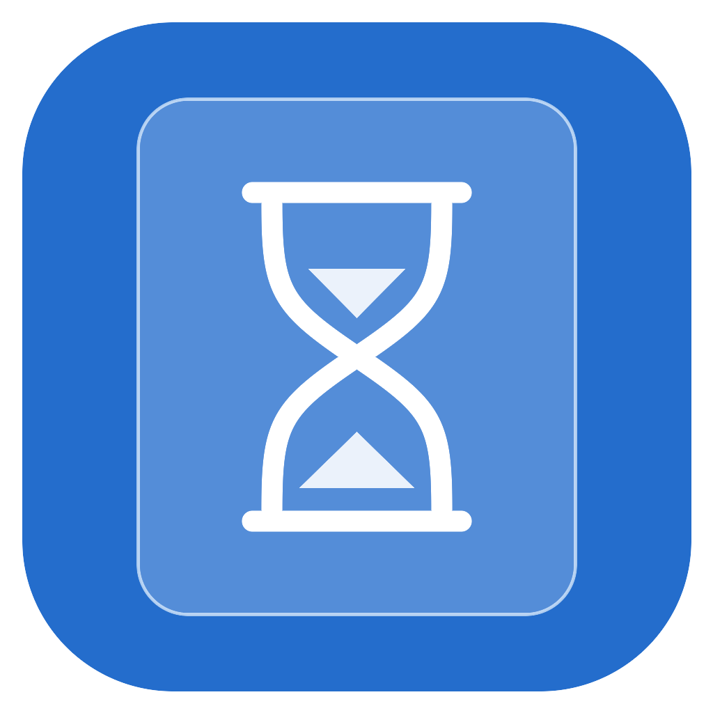
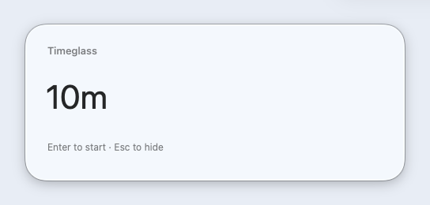

# Timeglass



A small native macOS timer with the same glass styling as Clipglass.



1. Open Timeglass.
2. Type `10m` and press **Enter**.
3. Press **Enter** again while Timeglass is focused to stop.

**Escape** hides the window without stopping the timer. Click its Dock icon or
launch Timeglass again to see the countdown. Only one timer runs at a time.

Durations include `90s`, `10m`, `1h` and `1h 30m`. A bare number means minutes.
Decimals work too: `1.5m` is 90 seconds. Durations range from one second to one year.

## Notifications

Allow notifications when macOS asks on the first timer. macOS schedules the
notification with its default notification sound. It can deliver the alert even
after you quit Timeglass. Closing or hiding the window does not cancel it.
Reopen Timeglass and press Enter to cancel a running timer.

Sound, Focus modes, and banner presentation follow macOS notification settings.
If notification permission is denied, the app explains how to enable it rather
than silently starting a timer that cannot alert you. If notification sound is
disabled, it shows a warning and a link to notification settings.

The countdown uses a saved wall-clock deadline, so hiding the app or sleeping
does not reset it. A sleeping Mac may show the notification when it wakes;
Timeglass does not wake the computer. It cannot alert while the Mac is shut down.

## Download and install

**[Download Timeglass for Apple Silicon](https://github.com/moritzWa/timeglass/releases/download/v0.1.0/Timeglass-0.1.0-macos-arm64.zip)** · [All releases](https://github.com/moritzWa/timeglass/releases)

Requires **macOS 26 or later** and an **Apple Silicon Mac** (M1 or newer).

1. Download and unzip the archive.
2. Drag **Timeglass.app** into **Applications**, then open it.
3. Type a duration and press Enter. Allow notifications when macOS asks.

The download is Developer ID signed, notarized by Apple, and includes a stapled
notarization ticket. No developer tools or account are needed. Checksums are
provided on the release page. To update, replace the app with a newer download.

## Build from source

Requires Apple Silicon, macOS 26+, and Xcode Command Line Tools.
The app uses Swift, AppKit's native `NSGlassEffectView`, and UserNotifications.
No webview, account, network client, package dependency or background server.

```sh
git clone https://github.com/moritzWa/timeglass.git
cd timeglass
sh scripts/test.sh
sh scripts/build.sh
sh scripts/install.sh
```

Packaging uses an available Developer ID certificate, or ad-hoc signing if none
exists. Source builds are for local development. Official release archives are
notarized; see [release instructions](docs/RELEASING.md) for signing and verification.

The editable icon is `assets/Timeglass.svg`. Rebuild it with
`python3 scripts/build-icon.py` (Pillow, ImageMagick and macOS iconutil).

## Local state and diagnostics

One small file, `~/Library/Application Support/Timeglass/timer.json`, records the
current timer's deadline, input and notification identifier. Stopping or finishing
the timer removes it. There is no history, telemetry or clipboard access.

To inspect notification authorization and pending/delivered counts without
starting a timer:

```sh
/Applications/Timeglass.app/Contents/MacOS/timeglass --notification-status
```

Model tests cover duration validation, countdown formatting, elapsed deadlines,
state round-trips and clearing stopped timers. Native checks run in a muted
macOS VM, never through sound playback on the user's desktop.
See [test results](docs/TESTING.md).

## License

[MIT](LICENSE). Contributions are welcome; see [CONTRIBUTING.md](CONTRIBUTING.md).
